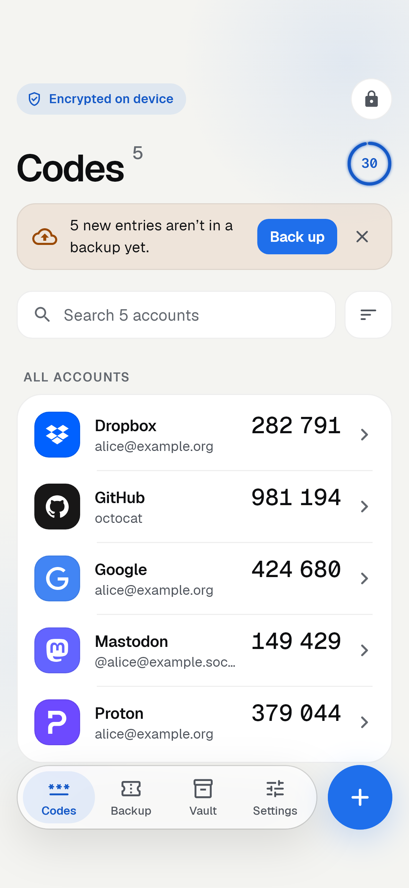
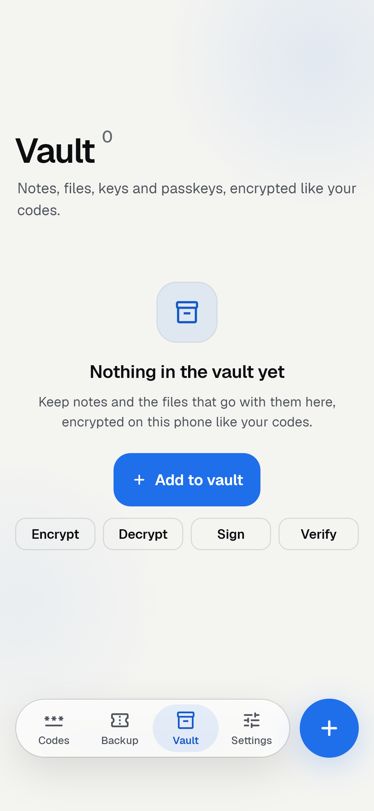
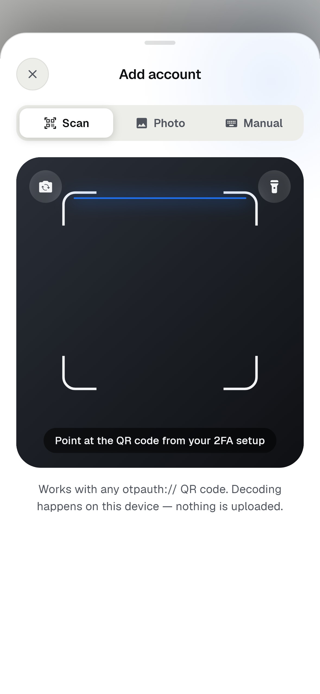
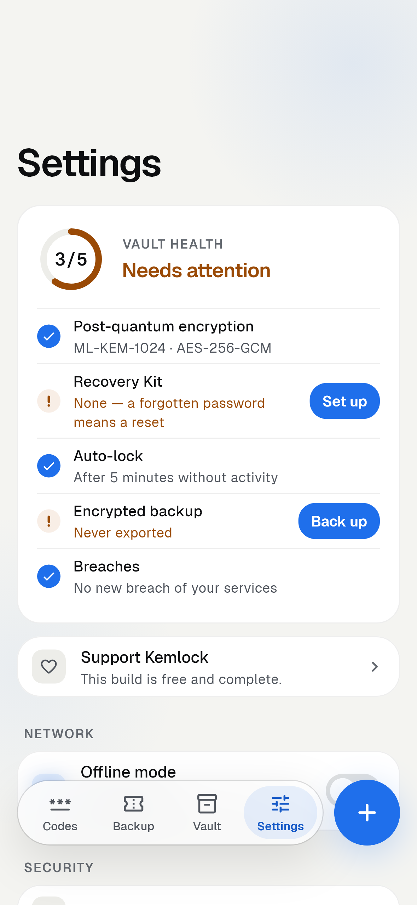

<p align="center">
  <picture>
    <source media="(prefers-color-scheme: dark)" srcset="mobile/assets/brand/kemlock-wordmark-dark.svg">
    
  </picture>
</p>

<h3 align="center">The post-quantum encrypted authenticator and password manager</h3>

<p align="center">
  Codes, logins, passkeys, keys and notes in one local-first vault, sealed with ML-KEM-1024 and AES-256-GCM.
</p>

<p align="center">
  <a href="https://github.com/Arsslensoft/Kemlock/actions/workflows/ci.yml"></a>
  <a href="https://github.com/Arsslensoft/Kemlock/actions/workflows/release.yml"></a>
  <a href="https://github.com/Arsslensoft/Kemlock/actions/workflows/codeql.yml"></a>
  <a href="https://scorecard.dev/viewer/?uri=github.com/Arsslensoft/Kemlock"></a>
  <a href="https://www.bestpractices.dev/projects/17053"></a>
  <a href="https://api.reuse.software/info/github.com/Arsslensoft/Kemlock"></a>
  <a href="LICENSE"></a>
  
  <br>
  
  
  
  
  
  
</p>

<p align="center">
  <a href="#features">Features</a> ·
  <a href="#security-architecture">Security</a> ·
  <a href="#getting-started">Getting started</a> ·
  <a href="docs/reproducible-builds.md">Reproducible builds</a> ·
  <a href="https://github.com/Arsslensoft/Kemlock-Server">Kemlock Server</a> ·
  <a href="https://github.com/Arsslensoft/Kemlock-browser">Browser extension</a>
</p>

<p align="center">
  
  
  
  
</p>

---

A **local-first**, **post-quantum encrypted** authenticator and password manager for iOS and Android, built with **Flutter** (in [`mobile/`](mobile/)).

- 🔐 **Post-quantum vault**: ML-KEM-1024 + AES-256-GCM, with a fresh key on every save. Nothing is stored in the clear.
- 🔢 **TOTP, HOTP and Steam Guard**, scanned from a QR code, typed in, or imported from Google Authenticator, Aegis, 2FAS and Bitwarden.
- 🔑 **Logins, passkeys, SSH and PGP keys, secure notes**, all in the same vault. The PGP keys can be post-quantum.
- ✍️ **AutoFill** of codes and logins in other apps and websites, after Face ID or a fingerprint.
- 🔄 **Sync you control**: a WebDAV folder, your own Vaultwarden, or [Kemlock Server](https://github.com/Arsslensoft/Kemlock-Server).
- 🧾 **Recovery Kit**, encrypted exports with a check, breach alerts, offline mode.
- 🆓 **Free and open source**: GPLv3, every feature free for everyone in every build, with no ads and no in-app purchases. The free build, made only of free software, is for F-Droid and the releases page.

## Security Architecture

### Post-Quantum Hybrid Encryption

All OTP secrets are stored encrypted. The scheme layers three cryptographic primitives:

| Layer | Primitive | Role |
|---|---|---|
| Key Derivation | **scrypt** (N=2¹⁷, r=8, p=1) | Password → 32-byte KEK |
| KEM | **ML-KEM-1024** (NIST FIPS 203) | Encapsulate a fresh 32-byte data key each save |
| Data Encryption | **AES-256-GCM** | Encrypt the ML-KEM private key and vault data |

**Step by step:**
1. On first launch, a master password is created. `scrypt` derives a 256-bit **key-encryption-key (KEK)**.
2. An **ML-KEM-1024** keypair is generated. The private key is AES-256-GCM encrypted under the KEK and stored on the device.
3. Every save encapsulates a fresh shared secret to the public key; the accounts JSON is AES-256-GCM encrypted with that secret. This gives **forward secrecy per save**.
4. On unlock: `scrypt` re-derives the KEK, decrypts the private key, then ML-KEM decapsulation recovers the shared secret to decrypt the data.

**Nothing is ever stored in plaintext.** The private key and KEK only live in memory while the vault is unlocked. The one place codes leave the vault is [AutoFill](#autofill), and only for a vault it is turned on for.

ML-KEM-1024, Keccak, scrypt and the SHA-256 behind PBKDF2 are written in Dart (`crypto/` in [Kemlock-core](https://github.com/Arsslensoft/Kemlock-core), the platform-free Dart the app shares with the browser extension; `mobile/lib/crypto` exports it), ported from `@noble/post-quantum` and `@noble/hashes`, and tested against vectors those libraries made from fixed seeds. AES-GCM comes from the `cryptography` package. Key derivation runs in a background isolate so the UI keeps moving.

### Kemlock Server account keys

An account on Kemlock Server has its own key hierarchy, which never touches the vault above: nothing in it changes how the vault, exports or sync files are sealed. Every format is fixed by `docs/crypto.md` in the Kemlock server repository, and the Dart code (`mobile/lib/crypto/account` and `mobile/lib/crypto/opaque`) follows it byte for byte:

- **Keys.** A 64-byte root key, the user key `HKDF(root, "kemlock/v1/user")` and its labelled children for item keys, private keys and the manifest.
- **`aead1`.** Every symmetric seal is AES-256-GCM, bound to its place by additional data.
- **`kx1`.** The exchange key, ML-KEM-1024 and X25519 combined as X-Wing combines them, with a sealed box on top for keys sent to an account, a device or a member.
- **`sig1`.** The signing key, ML-DSA-65 and Ed25519, both of which must verify. A public-key bundle signed by it has a 60-digit fingerprint people compare.
- **`kem1`.** The item envelope: each item has its own key, and its ciphertext is bound to its id, revision, kind and owner, so an item served in another's place does not open.
- **Signed manifest.** A counter and one entry per item, signed with `sig1`, which shows rollback, withheld items and replayed deletions.
- **`opaque1`.** Password sign-in by OPAQUE-3DH (RFC 9807) over ristretto255 (RFC 9496, RFC 9497), written in Dart. The password's Argon2id master key goes in, and the export key that comes out is the second half of what wraps the root, so neither the server's database nor the password alone opens it.

### Where the vault is stored

The vault lives in native key-value storage (`UserDefaults` on iOS, `SharedPreferences` on Android), under the same `CapacitorStorage` keys the earlier Capacitor build used. Kemlock's app id, `com.kemlock.app`, isn't the BackMyCodes app's `com.backmycodes.app`, so it installs beside that app rather than over it, and a vault moves across through an encrypted export. The app loads it into memory before the first frame; writes go to memory at once and to storage in order.

### Files attached to notes

A file attached to a secure note is kept apart from the vault, which is small and read whole at launch. Each file gets its own random 256-bit key and is encrypted before any of it is written, in the `KMA1` format (`mobile/lib/crypto/attachment_format.dart`): 64 KiB chunks of AES-256-GCM, each with its own nonce and a flag on the last one, so a changed, reordered or cut-short file is refused and shows nothing. The file's key, name, type and size are kept only in the note, inside the vault, so the file is as post-quantum as the rest. The encrypted files sit in the app's own support folder, `attachments/<vault>/<id>`, named by a random id that says nothing about them; deleting a vault deletes its folder, and a reset deletes them all. A picture is decrypted in memory to be shown, and the one copy ever written in the clear is the one you save or share, after a warning.

### Recovery Kit

A Recovery Kit is a random 256-bit key that opens the vault without the master password. The vault's private key gets a second AES-256-GCM wrap under it, and encrypted exports made while the kit exists carry one too. The key is split with Shamir's secret sharing over GF(256) (`mobile/lib/features/recovery/shamir.dart`) into pieces printed as QR codes and text (`BMCKIT1-…`, with a checksum that catches typos). A kit can be a single piece for yourself, or split between trusted people ("any 2 of 3"). Making a new kit stops the old pieces opening the vault; exports made before still open with them.

### Biometric unlock

Face ID, Touch ID or a fingerprint opens a vault without the master password, with a key the phone's secure hardware holds. A random 256-bit seal key wraps the vault's ML-KEM-1024 private key (AES-256-GCM), and the app's storage keeps only that wrap (`backmycodes_hardware_bio`). On iOS the seal key is a Keychain item that opens only after Face ID or Touch ID with the biometrics enrolled when biometric unlock was turned on, while the phone has a passcode, on this phone only and never synced (`mobile/ios/Runner/UnlockKeyChannel.swift`). On Android it is encrypted by an AES-256 key in the Android Keystore, in StrongBox where there is one, which needs Class 3 ("strong") biometrics for each use (`mobile/android/app/src/main/kotlin/com/kemlock/app/unlock`); a face unlock the phone doesn't class as strong can't open it, so such phones aren't offered biometric unlock. Every unlock shows the prompt. Adding a face or fingerprint, or removing the iPhone's passcode, turns biometric unlock off, and the lock screen says why; the next password unlock offers to turn it on again. A copy of the app's storage, from a backup or a rooted phone, opens nothing without the password, and the entry is in no export, sync file or Vaultwarden item.

Versions before this one kept the seal key in the app's storage, beside the private key it seals. Such an entry moves to the hardware at the vault's next biometric unlock, with no extra prompt, and is deleted once the new one has opened the vault. A backup of the app's storage made before that, such as an Android cloud backup or an unencrypted Finder backup, still holds the old seal key and opens the vault without the password. Changing the master password doesn't change that, since the private key stays the same; [replacing the vault key](#replacing-the-vault-key) does, for what the vault holds from then on.

### Replacing the vault key

Settings › Security › Replace vault key gives a vault a new ML-KEM-1024 key pair, once its master password is typed again, so a copy of the old private key, such as the one an old phone backup holds, opens nothing the vault holds from then on (`replaceKeyPair` in `mobile/lib/vault/vault_store.dart`). The new private key is wrapped under the same password and salt, and every value sealed to the old pair is sealed to the new one again with its contents byte for byte as they were, those a newer version wrote included: accounts, backup codes, notes, keys, passkeys, and the sync and Vaultwarden settings. Nothing that travels changes: exports, sync files, QR transfers, invites, Recovery Kit pieces and Vaultwarden items keep their formats, and the vault's other phones sync on as before.

It can't lose the vault. The old private key is first written down sealed to the new pair alone, and one write of the config is the commit. Cut short before it, the vault is as it was and the next unlock deletes what was left; cut short after it, the next unlock, by password or by the new kit, seals the rest. Edits and sync wait while it runs. The Recovery Kit goes with the old key, since an old backup holds its key too: the person makes a new kit of the same shape first, or goes on without one. Biometric unlock is turned off, its entries and hardware key deleted, and offered again at the end. The passkey inbox gets a new key, and a passkey that waited under the old one is still picked up.

A vault whose key Kemlock knows was in an old biometric entry is offered the replacement once it opens, and its Vault health card says so until it is replaced. That is known only once the vault is open, so the lock screen shows nothing, for hidden vaults too. A vault that had biometric unlock on and turned it off before this version can't be told apart, so the Settings row is there for every vault, with a hint saying when to use it.

What it doesn't undo is what an old phone backup already holds, and the last screen says so, a line for each thing the vault has:

- **Codes**: their secrets. Set two-factor authentication up again, the accounts that matter most, such as email and banking, first.
- **Backup codes**: make new ones where the service allows it.
- **Keys**: replace them on the servers and services they open.
- **Passkeys**: make new ones with each service, and remove the old ones there.
- **Notes**: what they say, and the files attached to them.
- **WebDAV sync**: the WebDAV password and the sync passphrase's key. Change the password on the server, then turn sync off and on again with a new passphrase.
- **Shared spaces**: their keys. Whoever runs a space can make a new one and invite everyone again.
- **Vaultwarden**: the sign-in. Change the account's master password and sign out its other sessions.
- **Exports made while the old kit existed**: they still open with their password and with the old pieces. Make a new export, and delete the old ones.

Old backups and old exports go on opening with whatever opened them before: nothing on the phone can reach them.

### Wrong passwords

The lock screen counts each wrong master password against the vault it shows, or against the phone when every vault is hidden, and writes the try to the app's storage before the password is checked, so quitting or killing the app doesn't take it back (`mobile/lib/features/lock/unlock_attempts.dart`). It shows how many wrong passwords were typed since the vault last opened and when the last was. Opening from the lock screen, by password, biometrics or Recovery Kit, sets that count back to zero, and the vault says once how many there were. A hidden vault opening there does exactly what the vault on screen opening would have done, so the count gives no hidden vault away. Wrong biometrics aren't counted.

Optionally (Settings › Security, off by default), every vault on the phone is erased after 10, 15 or 20 wrong passwords in a row on the lock screen, as the lock screen's reset erases them, biometric keys included. The lock screen warns from three tries left, and the setup screen then says when the vaults were erased and after how many wrong passwords. The setting is for the whole phone, because erasing only the vault on screen would give a hidden one away, and the limit counts each listed vault's tries apart. Exports and sync are the way back.

Neither stops someone with a copy of the app's files. The count and the setting are kept in the clear in the app's storage, like the vault's config: whoever can read it can guess offline, where only a strong master password holds them back, and whoever can write it can reset the count. A vault that opens with its password and a security key holds there too: a password guessed from the copy opens nothing without the key, though a phone backup made before the key was turned on still opens with the old password alone until the vault's key pair is replaced.

### Breach alerts

The breaches of a vault's services are found on the phone, by matching each account's issuer and each backup-code list's service against the bundled list (`mobile/lib/features/breaches`); nothing about the vault is sent anywhere. A breach counts against the vault's health when Have I Been Pwned listed it after the entry was added, until it is marked dealt with, which is kept on the entry and so travels with exports and sync.

Updating the list is a separate switch, off by default (Settings › Security). With it on for the open vault, the app asks Have I Been Pwned for its latest breach, at most once a day, and downloads the whole public list only when that breach is one the phone doesn't know. Both requests are the same from every phone and carry nothing from the vault; Have I Been Pwned sees the phone's IP address and that it runs Kemlock. The downloaded list is kept in the app's storage, in the clear like the bundled one, and a reset removes it.

### Password leak check

Off until it is turned on, at setup or in Settings › Security, Kemlock checks a new master password against the passwords known from data breaches, through [Have I Been Pwned](https://haveibeenpwned.com)'s Pwned Passwords (`mobile/lib/features/breaches/pwned_passwords.dart`). It sends the first five characters of the password's SHA-1 hash, asks for a padded answer, and looks for the rest of the hash in that answer on the phone: the password and the whole hash never leave it. The request is made once, when the password is submitted, never while it is typed, and a check that can't be made blocks nothing.

Those five characters are 20 bits of the hash, and that is the price of the check. Alone they open nothing. Someone who had both a copy of the vault and a record of that one request could throw out all but about one in a million guesses with a cheap SHA-1 before paying for scrypt. That is why the check is off by default, is offered again each time a vault is made, and says what it sends.

### Finding keys by email

Kemlock looks someone's key up by email only when asked, from "Find by email" or a contact's "Look for a newer copy" (`mobile/lib/features/contacts/lookup`), and says who will be asked before anything is sent. The address's own domain is asked first, through its Web Key Directory, and learns the whole address being looked for; the phone's name resolver learns the domain. Only when the domain gives no key, and only after a second tap, is the address sent to keys.openpgp.org. Each request is an HTTPS `GET` with `User-Agent: Kemlock` and nothing about the person, the vault or the phone; no search is remembered, offline mode stops them all, and a key found this way is unchecked until its fingerprint is compared, like any other.

### Post-quantum PGP keys

A PGP key can be post-quantum in two formats, since the programs people use don't yet agree on one (`mobile/lib/crypto/keys/openpgp/`):

- **Standard**, as RFC 9980 defines it: a version 6 key whose primary key signs with ML-DSA-65 and Ed25519 together and whose subkey encrypts with ML-KEM-768 and X25519 together. Sequoia and the other programs that follow RFC 9980 read it; GnuPG does not. A message to such keys alone goes in the version 2 encrypted-data packet, AES-256 with OCB.
- **For GnuPG**, in LibrePGP's format as GnuPG 2.5 writes it: GnuPG's usual Ed25519 primary key with a version 5 subkey of Kyber-768 and X25519 to encrypt. GnuPG 2.5 reads it; programs that follow RFC 9980 do not. Its signatures stay Ed25519, so only what is sent to it is post-quantum.

In both, the two parts of a pair must hold together: the ML-KEM and X25519 shared secrets go through one key derivation (SHA3-256 in RFC 9980, KMAC256 in LibrePGP), so a message opens only when both steps ran, and a signature is good only when both the ML-DSA and the Ed25519 signature verify. Breaking one algorithm, the old or the new, gives nothing. ML-DSA signing and KMAC are written in Dart like ML-KEM, tested against NIST's vectors and RFC 9980's samples, and the keys and messages were checked with GnuPG 2.5.24 and Sequoia's `sq` 1.5.0 (`mobile/test/fixtures/keys/gnupg/pqc`, `mobile/test/fixtures/keys/sequoia/pqc`).

The other post-quantum algorithms of both formats (ML-DSA-87 with Ed448, ML-KEM-1024 with X448, SLH-DSA, and Kyber on X448, brainpoolP512r1 or a NIST curve) are only shown: a key holding them is read, kept and named, but Kemlock does not sign, encrypt or decrypt with them. Kyber on brainpoolP256r1 or brainpoolP384r1, which GnuPG's own shortcut makes, is used but never made here.

A standard public key is about 18 KB armored, against under 1 KB for Ed25519. That is too long for a QR code, so its sheet's code holds its fingerprint alone and says the key must go as a file, and for the notes of a readable Vaultwarden item: a plain Vaultwarden home leaves the key on the phone and the sync screen counts it among the items too long to write. A GnuPG-format key, about 2 KB, fits such an item. Sync files, sealed Vaultwarden homes and exports carry both kinds as they carry any key.

### AutoFill

Turned on for a vault in Settings › AutoFill, Kemlock fills one-time codes into other apps and websites: from an AutoFill extension on iOS 18 and up (`mobile/ios/AutoFill`), and an autofill service on Android 8 and up (`mobile/android/app/src/main/kotlin/com/kemlock/app/autofill`). Neither can open the vault itself (scrypt with the vault's parameters needs 128 MiB, more than an iOS extension may use), so while the vault is open the app writes an *autofill copy* of its TOTP and Steam accounts, sealed to a key only the phone's secure hardware holds: a Secure Enclave P-256 key (ECIES) on iOS, an RSA key pair in the Android Keystore, in StrongBox where there is one (RSA-OAEP and AES-256-GCM). Writing needs only the public key; opening needs Face ID, Touch ID or a strong fingerprint (on Android, in the ten seconds before), and the key stops working when the biometrics change. The copy stays on the phone, out of its backups. HOTP accounts and hidden vaults are never filled, and turning AutoFill off, deleting the vault or resetting from the lock screen deletes the copy.

A code is suggested only on its account's own site, the issuer's domain or the 2FA directory's and their subdomains, its own websites, and those of the login it is linked to, compared label by label (hosts anyone can open a tenant under, such as okta.com, only exactly), or in an app the person picked it for, signed with the same certificate. On Android a website counts only from a browser on the bundled list of trusted browsers, with its certificate, and only for the frame the field is in. With "Name the service in suggestions" on, as it is by default, the issuers and their domains are kept outside the vault in the clear, so a suggestion can say GitHub before biometrics; account names, emails and secrets never are.

Passwords are turned on apart, with "Fill passwords from this vault" (off until turned on), and then the copy holds the vault's logins too, passwords and all. Because a password manager has to name the login before it may open anything, the index keeps each login's name, username and domains in the clear while passwords are on, and the AutoFill sheet says so; a password is never kept in the clear. A login is suggested on its own sites, the registrable domain of each of its websites as the bundled Public Suffix List draws it, by the same rules as a code, and the code of the account linked to it is offered on the page after the password. "Suggest strong passwords" offers a random password on sign-up and change-password forms, following the site's rules from Apple's password rules list (`password-rules.json`) where it has some, made by the same generator in Kotlin and Swift as in Dart and held to the same passwords by `mobile/test/fixtures/generator/cases.json`; a passphrase is made in the app only. "Offer to save new logins" lets the phone keep a login after a form is sent: Android's save prompt, which offers a changed password as an update, and, on iOS 26.2 and up, the system's own generate and save requests. Before iOS 26.2 an iPhone fills passwords only, and the sheet says so.

Neither AutoFill can open the vault, so what it saves waits in the vault's *inbox* until the vault is next opened: a login it saved, a password it changed, or a password it generated and filled, each a file of its own named `login-<uuid>.json`, sealed to the vault's inbox key (P-256 ECDH with a fresh key, HKDF-SHA-256 with the info `kemlock-login-inbox-v1`, AES-256-GCM). The phone holds only the public half of that key; the private half is in the vault, so the files open in the app and nowhere else, and they sit outside the folder of the copy, so a change of biometrics doesn't lose them. Opening the vault takes them in: a saved login updates the login of the same id, or of the same site and username, keeping the password it replaces among the previous ones, or is added, tagged New, with a toast counting them. A generated password no save followed is kept in the vault, under the generator's Recently generated, for 30 days (`backmycodes_generated_data`, never synced or exported). The app asks the phone to delete the files only once the vault has saved what they held, so a failed save loses nothing and taking them twice adds nothing twice. Turning saving off, with passkeys off too, takes the files in first, then the inbox key off the phone.

What AutoFill keeps, per vault, is on Android in `noBackupFilesDir`, out of the phone's backups: `autofill/<vault>.copy` (sealed), `autofill/<vault>.index.json` (in the clear), `autofill/<vault>.picks` and `autofill/<vault>.picks.json` (the apps and sites the person picked an account or a login for, with the app's certificate), `autofill/<vault>.takes.json` (whether the phone may save passkeys and logins for the vault, and suggest passwords), and `inbox/<vault>.key` and `inbox/<vault>/` (the inbox key's public half and the files waiting). On iOS it is in the App Group container both the app and the extension open: `Autofill/<vault>.copy`, `Autofill/<vault>.index.json`, `Autofill/<vault>.picks`, `Autofill/<vault>.picks.json`, `Autofill/<vault>.passkeys.json` (the vault's record: its name, the inbox key's public half and what the phone may do for it) and `inbox/<vault>/`. Turning passwords off takes the logins out of the copy and the index; a vault deleted or hidden, or the lock screen's reset, deletes all of it.

### Mail apps (Android)

Thunderbird for Android, K-9 Mail and FairEmail hand their OpenPGP work to an "OpenPGP app" on the phone, through the interface OpenKeychain defined; Kemlock can be that app (`KemlockPgpService`, with the interface's files copied from `open-keychain/openpgp-api` under Apache-2.0). The first request from an app brings up Kemlock, which names the app and its package and asks whether to allow it, and which of the vault's PGP keys it may sign and decrypt with. The approval is kept sealed in that vault, pinned to the app's package name and the SHA-256 of the first certificate of its signing lineage, so an update signed after a key rotation still matches and an app that only carries the same name is asked about again, with a warning; an app signed by several signers is refused. Approvals are in no export, backup, sync file or space.

An approved app can use its allowed keys whenever the vault is open, without asking, for as long as it stays approved: Remove in Settings › Mail apps that use your PGP keys ends that at once. A mail app's requests are not you using Kemlock, so the vault still locks after its idle time and when Kemlock is closed. While no vault is open, every request from every app gets the same answer, that you are needed, whatever vaults, keys or approvals exist; Kemlock comes up only when the mail app, in front, asks for it, and a mail checked in the background brings up nothing. A protected key's passphrase is asked on Kemlock's own screen, never taken from the mail app, and the opened key is kept in memory until the vault locks.

A hidden vault's approvals are kept inside it and used only while it is the open vault; with another vault open, its keys are answered for as keys Kemlock never held. What Kemlock cannot hide is what the mail app keeps: the key ID it was told to sign with, and the mail itself, so anyone who opens the mail app can learn that a hidden vault's key exists. Approving an app in a hidden vault says so first. The provider needs a check on a real phone before it ships: it shares the app's one Flutter engine with a bound service.

### Sharing to Kemlock

Text or a file shared from another app goes to the Kemlock app itself, which unlocks as it always does; the part in the other app's share sheet holds no key and never reads the vault (on iPhone it could not: opening a vault takes more memory than iOS gives an extension). Until a vault is open the item waits, ten minutes at most, and the lock screen says only that something was shared. Meanwhile, on Android, a text is kept in memory and nothing is written, and a file is copied into the app's own cache, out of the phone's backups. On iPhone the share screen writes the text or the file into the App Group it shares with the app, with complete file protection, so it can't be read while the phone is locked, and out of backups; the app reads a text from it, or moves a file into its own cache, as it takes it. Each copy is deleted once the item is used or dropped, when it is ten minutes old, and when every vault is erased, and none names a vault.

## Features
- **Post-Quantum Vault** – ML-KEM-1024 + AES-256-GCM, in native storage
- **Service logos** – about 230 bundled [Simple Icons](https://simpleicons.org) (CC0)
- **Recovery Kit** – a printable key that opens the vault, and its exports, if you forget the password
- **QR Code Scanning** – camera or a picture from the library
- **Manual Entry** – secret key, issuer, digits, algorithm, period
- **TOTP, HOTP and Steam Guard** – time-based codes with a countdown, counter-based codes generated on request, and Steam's 5-character codes
- **Copy to Clipboard** – one tap per account
- **AutoFill** – the code suggested above the keyboard in other apps and websites, typed in after Face ID or a fingerprint (iOS 18 and Android 8 and up); with passwords on, logins too, a strong password suggested on sign-up forms, and new and changed logins saved, even while the vault is locked (on iOS, generating and saving need iOS 26.2)
- **Logins** – each login's name, websites, username and password, with a note and tags, the code it goes with linked so the account's code sits beside its password, and its last five passwords kept when it changes, whether by an edit, by AutoFill or by a sync where two phones each changed it. A generator makes random passwords or EFF word-list passphrases on the phone. Logins sync over WebDAV, in the vault's file and its spaces', and travel in exports; QR transfers and Vaultwarden sync don't carry them yet. Free
- **Set-up links** – a site's `otpauth://` link, or a Google Authenticator export, opens in the add-account sheet
- **Import from other apps** – Google Authenticator transfer QR codes, Aegis (plain or encrypted), 2FAS (plain or encrypted), unencrypted Bitwarden JSON, and text files of `otpauth://` links
- **Encrypted export with a check** – after saving an encrypted export, retype its password to prove the file opens. An export holds the codes, backup codes, keys, notes, passkeys and logins; a vault with attached files exports as a `.zip` of the export file (`export.json`) and the files, which stay encrypted under their own keys, and the check opens every one. Versions from before keys, notes and passkeys import an export's codes and leave the rest. QR transfers carry the codes and backup codes alone
- **Breach alerts** – the Vault health card and each account's sheet say when a service in the vault has had a data breach since it was added, from a bundled copy of [Have I Been Pwned](https://haveibeenpwned.com)'s list (CC BY 4.0). The check runs on the phone and sends nothing; a breach can be marked dealt with. Optionally, the app asks Have I Been Pwned once a day for breaches newer than its copy
- **Password leak check** – optionally checks a new master password against the passwords known from data breaches; five characters of its SHA-1 hash go to Have I Been Pwned, the password stays on the phone
- **Offline mode** – one switch in Settings after which Kemlock makes no network request at all: sync and attached-file downloads, the breach list update and the password leak check and on Android the check that lets an app (not a browser) sign in with a passkey. Each says it is paused where it would have used the network, no setting is lost and turning the switch off resumes everything. It is the phone's, not a vault's. What other apps do is not Kemlock: a link you open goes online in your browser, after a question that shows the address, and the phone's file picker may fetch a file you choose from a cloud provider
- **Backup reminders** – the Codes tab and Vault health card count the accounts added since the last encrypted backup
- **Auto-lock** – after 1, 5, 15 or 60 minutes without activity, and optionally as soon as the app is hidden (paused while a system file picker, share sheet or permission prompt is open)
- **Wrong-password count** – the lock screen shows how many wrong master passwords were typed since the vault last opened, and when the last was, and the vault says so once when it opens; a restart doesn't clear it
- **Erase after wrong passwords** – optionally, every vault on the phone is erased after 10, 15 or 20 wrong passwords in a row, with a warning from three tries left. Like the count, it stops someone at the lock screen, not someone who copied the phone's files: against them, only a strong master password helps
- **Screen privacy** – on Android, codes are kept out of screenshots, screen recordings and the recent-apps preview (`FLAG_SECURE`); on iOS the app is blurred in the app switcher
- **Undo** – a removed account can be restored from the toast for a few seconds
- **Notes** – a free-text note on each account and backup-code service, and the date each backup code was used
- **Secure notes** – notes of their own on the Vault tab, with a title, up to 10,000 characters of text, tags and a pin, kept encrypted with the codes and searched by what they say
- **Keys** – key pairs on the Vault tab, generated on the phone or imported, with their public halves ready to copy, share or show as a QR code: SSH keys (Ed25519, ECDSA P-256, RSA 3072 and 4096), signing keys (Ed25519, ECDSA P-256 and P-384, RSA, post-quantum ML-DSA-65), exchange keys (X25519, post-quantum ML-KEM-768 and ML-KEM-1024) and OpenPGP keys (Ed25519 with a Curve25519 subkey, RSA 4096, or post-quantum). Imports read OpenSSH keys, PKCS#8 (PEM or DER, plain or PBES2-encrypted), PKCS#1, SEC1 and OpenPGP secret keys; a key of an algorithm Kemlock doesn't know is kept as it was given. The private half leaves the vault only when asked, after a warning and biometrics: shown, copied to the clipboard that clears itself, or exported as an OpenSSH file, an armored PGP key or a PKCS#8 PEM, protected by a passphrase unless that is turned off
- **Post-quantum PGP keys** – a PGP key that holds against a quantum computer, generated on the phone (the standard one by default) or imported, in RFC 9980's standard format (ML-KEM-768 with X25519 to encrypt, ML-DSA-65 with Ed25519 to sign), which Sequoia reads, or in GnuPG's LibrePGP format (Kyber-768 with X25519 to encrypt, signatures in Ed25519), which GnuPG 2.5 reads. It encrypts, decrypts, signs and verifies like any PGP key; the Encrypt sheet says whether a message is post-quantum protected, and the key sheet who reads the key
- **Key expiry warnings** – a PGP key that expires within 30 days, has expired or was revoked is tagged on the Vault tab, and its sheet says what that means, for the key and for each subkey. Optionally, a notification 30, 7 and 1 days before a key expires and on the day, scheduled on the phone; it names no key and no vault, and a hidden vault never sends one
- **Change a PGP key** – a PGP key's sheet adds a subkey (to encrypt or to sign), adds a user ID, changes when the key or one of its subkeys expires, and revokes the key or makes a revocation certificate to keep. Each change is signed by the key's own primary key, after biometrics when the vault has them and the key's own passphrase when it keeps one, and only adds to the key: its fingerprint stays, and GnuPG and Sequoia take the changed key. A copy of the key imported later, or changed on another phone before they synced, is combined with it, so no change is lost. Two things to know: the people who use the key see a change only once they have its new public key, so send it to them again (the sheet offers to share it); and a revocation can't be taken back once the revoked key has left the phone; before that, only restoring an older backup undoes it
- **SSH signatures** – an SSH key in the vault (Ed25519, ECDSA P-256 and P-384, RSA) signs a file or typed text in OpenSSH’s signature format (SSHSIG, what `ssh-keygen -Y sign` writes), for a file, a git commit or tag, or a namespace you name; `ssh-keygen -Y verify` and git accept it, and the key stays in the vault. Kemlock also verifies such a signature, or a commit or tag git signed with an SSH key, and says whose key made it: one of the vault’s, the public key you pasted, or one it doesn’t know, with its fingerprint to compare
- **Security keys** – Settings › Security keys manages a FIDO2 key of any brand that follows the standards: set or change its PIN, see and delete the passkeys on it, manage its fingerprints, and reset it, each only where the key itself says it can. A key is held to the phone (NFC) or plugged in (USB) on Android, and held to the phone (NFC) on iPhone, which gives apps a key's passkey features over NFC only. Kemlock looks for a key only while the sheet is open, keeps the key's PIN only that long, and stores nothing about a key. A PIN is sent as typed; type accented characters the way the computer that set the PIN did. No brand has been tried on a real key yet: the protocol code is tested against a software key, and the phones' NFC and USB code is untested on hardware
- **PGP messages** – Encrypt, Decrypt, Sign and Verify on the Vault tab, for text and for files of any size, with the vault's PGP keys or with a passphrase alone. Kemlock writes what every OpenPGP program reads (AES-256 with integrity protection, SHA-512 signatures, clear-signed text, detached `.sig` files), and GnuPG 2.4 takes it without a warning. It reads what GnuPG and RFC 9580 programs write: messages to RSA, Curve25519 and X25519 keys, GnuPG's OCB form and the RFC's OCB, GCM and EAX forms, AES-128 to AES-256, ZIP, ZLIB and BZip2, and `gpg -c` passphrases. What it does not read it refuses by name: messages with no integrity protection, CAST5 and the other old ciphers, Argon2, version 3 signatures, DSA, Elgamal and keys on NIST, Brainpool and other curves. A signature made with SHA-1 or MD5 is shown as not trusted. Nothing decrypted is saved: the text is gone when its sheet closes, a decrypted file unless you save it, and a key's own passphrase is asked for each time
- **Other people’s keys** – the OpenPGP public keys of the people you write to, kept sealed in the vault and listed on the Vault tab under Keys: added by scanning the QR code another Kemlock shows, from a file or from pasted text. A key gets in only if every signature it makes over its own names and subkeys verifies, so a subkey slipped in on the way is refused. Before it is kept, its fingerprint is shown in groups of four to compare with its owner; the vault remembers whether that was done and when, for that key alone, and a key that was never compared says so wherever it is used. A newer copy of a key is merged in, so a revocation or a later expiry is never lost, and a different key for the same person is never swapped in silently
- **OpenPGP for Thunderbird, K-9 Mail and FairEmail (Android)** – Kemlock is one of the phone's OpenPGP apps, so those mail apps sign, encrypt, decrypt and verify with the vault's PGP keys and its other people's keys, which never leave the vault: each app approved once, for the keys you pick, and listed in Settings with Remove
- **Find a key by email** – type someone's address and Kemlock asks their own domain's Web Key Directory for their OpenPGP key, then, if it has none and after a second tap that says the address goes there, keys.openpgp.org. Only a key that names the address is taken, with that address alone, and its fingerprint is compared like any other's. A contact's key can be looked for again, to learn of a revocation or a later expiry. Nothing is looked up on its own, and it is free
- **Certificates on a security key (PIV)** – the Security key sheet's Certificates row shows the four PIV slots of a key (sign-in, signature, encryption and card) with each certificate's key, end date and details, and tags one that ends within 30 days. Kemlock has the key generate a key in a slot (RSA 2048, ECC P-256 or P-384) with a self-signed certificate or a request for an authority, imports and exports certificates, changes the PIN and the unblocking code (PUK) and unblocks the PIN, and resets the PIV application on keys that offer it. A key's factory management key is called out; changing it makes a random one that is kept as a secure note in the open vault before it is set, and Kemlock finds it there again by itself. No PIN or PUK is stored. Tested against a software card only; no key has been tried on a phone yet
- **Security key unlock** – Settings › How this vault opens chooses, for each vault, its master password, a FIDO2 security key and its PIN, or both together, where neither alone opens anything. The key gives a secret through `hmac-secret` after its PIN, from a credential that takes none of its passkey places; a second key or the Recovery Kit is the way back if the key is lost, and the kit brings the vault back to a password. Biometric unlock is off while a vault needs its key, a hidden vault never opens with a key alone, and nothing that travels changes. Android first: on iPhone it shows as not available until it is proven on real keys, and no key has been tried yet, the exchange being tested against a software key only
- **Change Master Password** – re-wraps the private key under a new KEK without regenerating the keypair
- **Replace vault key** – a new key pair for the vault, so a copy of the old private key, such as an old phone backup's, opens nothing it holds from then on; the Recovery Kit is replaced with it, and the last screen says what an old backup still gives away
- **Vault Reset** – emergency wipe of every vault on the device if the password is forgotten

### Sync, spaces and more

Kemlock also keeps a vault the same on more places, saves work, and brings other people in. Every feature below is free:

- **Sync** – keep a vault the same on all your devices through a WebDAV folder you control (Nextcloud, ownCloud, Synology, …) or your own Vaultwarden, with the codes sealed or as ordinary Vaultwarden logins. No Kemlock server is involved
- **Shared spaces** – put accounts, backup codes, keys and notes (files and all) in a space that syncs to family or a team through a shared WebDAV folder; passkeys stay in the vault
- **Recovery Kit for trusted people** – split the kit so that, say, any 2 of 3 people can open the vault
- **Several vaults** – Work and Personal, each with its own password; a vault can be hidden from the lock screen and opens when its password is typed there
- **Backup-code tools** – import codes from a screenshot, photo or PDF (on-device text recognition), see which accounts have no backup codes saved, and links to each service's page for new codes (from a bundled copy of [2fa.directory](https://2fa.directory), MIT)
- **Codes on a security key** – the codes of the accounts kept in a YubiKey's code application, read over NFC or USB and shown beside the vault's own, and an account moved or copied there, or added straight to the key. The secrets stay on the key: the vault, its backups and its sync keep the accounts' names, tags and notes only, and an export says how many are "on your key, not in this file". A key's password can be remembered on the phone as what proves it, never the password. Tested against a software key only; no real key has been tried yet
- **Tags** and a **custom order** for long account lists
- **PGP keys on a security key** – sign and decrypt with the PGP keys on a YubiKey or another OpenPGP card, add them to the vault, generate new ones on it, or move a vault key onto it. For such a key the vault stores its public half, GnuPG's stub (which holds no secret) and which card holds it; the card's PINs are never kept. A key moved without a copy is still in the exports and backups made before the move
- **Share to Kemlock** – text or one file shared from another app opens in Kemlock, after unlock: an encrypted message goes to Decrypt, a signed one to Verify, and anything else is offered to encrypt or sign

#### How sync works

A vault syncs in *scopes*: its own entries to `backmycodes-sync.json` in the chosen folder, and each shared space's entries to that space's file. The device encrypts each file with AES-256-GCM before upload: a vault's file under scrypt(sync passphrase) with the salt in the file, a space's under a random key that travels in an invite sealed with a one-time code. Entries merge by id and the most recently changed copy wins (`mobile/lib/features/sync/sync_merge.dart`); deletions are kept as tombstones for 180 days, and HOTP counters never go back. Writes use ETags (`If-Match` / `If-None-Match`) so two devices writing at once merge instead of overwriting. Sync runs on unlock, two seconds after a change, when the app returns to the front and every five minutes. Only https servers are accepted.

Keys, notes and passkeys travel in the same files as codes, in lists of their own that a file of codes alone never has, so versions from before them read those files as they always did and write the new lists and their tombstones back untouched (`mobile/test/fixtures/vault-items/sync-every-kind.json` holds both kinds of file, and the merge from before is kept in `mobile/test/compat` to check against). Keys and notes can go in a space; passkeys never do, because a passkey belongs to the phones that hold its vault. A file attached to a note is uploaded beside the document that names the note, as `backmycodes-file-<id>`: the `KMA1` file as the phone keeps it, written once with `If-None-Match: *` and never changed, and uploaded before the document so no phone reads a note whose file isn't there yet. A phone fetches the files it lacks after a sync, one at a time and smallest first, checks each opens with its key before keeping it, and fetches one first when its note opens it. A file goes from the folder once its attachment is removed, or its note deleted, on the phone that did it.

Other people's keys travel the same way, in a `contacts` list written only when the vault holds one, with whether each was checked and for which fingerprint: in encrypted and plain exports, in the sync file of the vault's own entries (never in a shared space's, since a check is one person's own statement), and in a Vaultwarden home as a sealed entry or, once agreed to, as a note holding the public key. An import only ever adds them, and reads each key again before keeping it. The same key added on two phones before they synced ends as one, checked if either was. A QR transfer leaves them out.

With Vaultwarden (or another Bitwarden-compatible server), the vault's own entries sync item by item into a *home*: a folder with a note that says how the home keeps its entries (`mobile/lib/features/sync/vaultwarden/`). Kemlock signs in as the Bitwarden apps do (PBKDF2 or Argon2id, a second step or a personal API key) and keeps the session, never the master password, encrypted with the vault. The second step can be a code (an authenticator app, email, or a YubiKey's one-time password, typed or read from the key by NFC) or a security key, over NFC on iPhone and over NFC or USB on Android: Kemlock speaks FIDO2 to the key itself, asks it only about the server's own name, and gives the address typed as the answer's origin, so the server takes the answer only at the address it is set up under (Vaultwarden's `DOMAIN`). Duo isn't supported. Each entry is one item, marked by a hidden field named `Kemlock`:

- **Sealed**: a note holding the entry under AES-256-GCM with scrypt(sealing passphrase), so whoever opens the Vaultwarden account sees only sealed notes.
- **Plain**: an ordinary login with its code (or a note for backup codes), which the Bitwarden apps show next to the passwords. A code can go in the user's own login, which then keeps its name, password, websites and fields as they were, and the account sheet shows that login's password. Anyone who gets into the Vaultwarden account then has both factors, which setup says before it's chosen.

Keys, notes and passkeys sync the same way. Sealed, each is a sealed note like any entry, and a note's attached files are attachments of its item: the encrypted file as the phone keeps it, under Bitwarden's attachment encryption too and named by a random id, so neither the server nor the Bitwarden apps can read them. Plain, the Bitwarden apps see:

| In Kemlock | In the Bitwarden apps |
|---|---|
| Note | A secure note with its title, text and favourite, and each attached file as an attachment under its real name, which the apps download and open |
| SSH key | An SSH key item (the private key in OpenSSH form, the public key, the fingerprint) on a server new enough to keep them (Bitwarden 2024.12 or later, as `/api/config` reports); on an older one, as any other key |
| Other key | A secure note with the public half in its text and the private half (PEM, or an armored PGP key) in a hidden field named `Private key` |
| Passkey | A login for the site (its name and address, the user name) holding the passkey, which the apps can sign in with |

Edits to their names, text and favourite made in the Bitwarden apps come back to Kemlock. Before a plain home gets its first key, note or passkey, the sync sheet says how many of each wait and that every app signed in to the account can read them, and writes none of a kind until the user agrees to it. A note longer than the server keeps (10,000 encrypted characters) stays on the phone and in its other backups, and the sheet names it. Files go only to the server Kemlock signed in to: one that keeps them on another host, or takes none, gets the items without their files, which stay on the phone. Versions of Kemlock from before keys, notes and passkeys leave their items alone.

Merging is the same as WebDAV's, with each write checked against the item's revision (`lastKnownRevisionDate`) instead of an ETag, and an idle sync costs one request for the account's revision date. Kemlock only ever moves its items to the trash, never changes a value of the user's it doesn't own, leaves an item it can't read untouched, and stops to ask before a sync that would remove more than a quarter of the entries. A self-signed server works by pinning its certificate's fingerprint. The tests in `mobile/test/vaultwarden_server` run against a real Vaultwarden and the official Bitwarden CLI when `VAULTWARDEN_URL` and `BW_CLI` are set.

#### Kemlock Server sync

Kemlock Server is a third backend, beside a WebDAV folder and Vaultwarden, and syncs the vault's own entries through the server's own API, `/kem/v1` (`mobile/lib/features/sync/kemlock/`, pure Dart). A vault's own entries sync through exactly one of WebDAV and Kemlock Server; WebDAV spaces keep syncing as they do.

- **Signing in.** The server's address must be https, and `/kem/v1/config` is read before anything is sent. The master password signs in through OPAQUE (RFC 9807): the server never receives a hash of it to test guesses against, and the Argon2id settings and salt are read, and checked against fixed bounds, before the first message. A Compatible account, copied from Bitwarden, sends the Bitwarden hash once and enrols OPAQUE in the same sign-in; once the phone has seen the account enrolled it never sends that hash for it again, so a server that later claims otherwise gets nothing. A passkey or security key with PRF signs in and opens the account (a security key over NFC or USB through the app's own CTAP code, a platform passkey through Credential Manager on Android 14 and later, never on iPhone); SSO opens the provider in the system's browser sheet (`ASWebAuthenticationSession`, Custom Tabs), bound by a PKCE of the phone's own and its device key, and then opens the account by this phone's trusted-device key, by another device's approval, or by the master password. An authenticator code, an email code or a security key answer a second step.
- **The device key.** Every request with a token carries a DPoP proof (RFC 9449), signed by a P-256 key that stays in the Secure Enclave (`AfterFirstUnlockThisDeviceOnly`, no user presence) or in the Android Keystore (StrongBox when there is one, no user authentication), so a token copied off the phone is useless elsewhere. A phone with no hardware key uses a software key sealed in the vault, and the sign-in sheet says so. The same key signs in to a replica, with no password. "Trust this phone" lets the server keep the account's key wrapped under a hardware key only this phone has, so SSO alone opens the account after sync is turned off and on; Settings removes that trust.
- **What the server sees.** The account's email; each item's id, revision, kind (`otp`, `login`, `note`, …), size and times, with its content sealed under the item's own key (`kem1`), so the content and the user key never reach it; the signed manifest; the devices and their names, addresses and last use of each API; the push token, and the Vaultwarden device identifier when the vault also syncs with Vaultwarden on that server, so one device shows once. It never has the master password, a hash of it, or the user key. A note's attached files go up as the same encrypted `KMA1` bytes. Each run checks the account's signed manifest, so a rolled-back, missing or resurrected item stops the run.
- **What the push relay sees.** On iOS, only the phone's device token and the times of its nudges, `sync` and `approval`, which carry no names or data: Kemlock's relay is the processor, under a data processing agreement, and the sign-in sheet says so. On Android, the push goes through the distributor the person chose (ntfy, NextPush, ...), which sees the endpoint it gave and the times of the empty messages; the server pushes to the endpoint itself. The push switch is on at sign-in and can be turned off. Without push (an Android phone with no UnifiedPush distributor installed), changes arrive over the live socket `/kem/v1/live` while the app is open and unlocked, and by the five-minute schedule. A request to sign in from another device, while the vault is locked, raises a notification with fixed words that names no device and no account.
- **Approving other devices.** A new phone or browser shows five words computed from its one-time key; this phone computes them again from the request and approves only after the owner's check. Approving seals the account's key to that device, and the server only relays it.
- **Failover.** The phone keeps the vault's server list, the home first and then its replicas, sealed with the vault. It switches after two failed requests or 10 seconds without an answer, signs in to the replica with its device key, and returns once the home has answered for five minutes. It takes a new home only with a promotion record signed by a server it already knows. Changes only the home may accept (the master password, two-step login) wait, and the sync sheet says which server is in use and since when.
- **What is kept on the phone.** Under the vault's `backmycodes_` keys, each sealed with the vault and deleted with it: `backmycodes_kemlock_session` (the tokens and device id, and the reason when the server ended the session), `backmycodes_kemlock_account` (the account's keys, as `add-account-crypto` seals them, and whether OPAQUE was seen) and `backmycodes_kemlock_cache` (the server's items as this phone last opened them, the cursor, the highest manifest seen and the deleted-id record). The sync settings gain a `kemlock` member (the account's id and email, the server list with its certificate pins, the device id, the push switch); an older build keeps it and sees sync as off. Turning sync off signs out on the server and deletes the three sealed values; the trusted-device copy on the server and the hardware key stay until trust is removed. Offline mode stops every request of it: sign-in, sync, the browser sheet, the socket, approvals, health checks and the push token.
- **Moving from Vaultwarden.** A Vaultwarden server whose `/api/config` has a `kemlock` member is offered as a move at most once a day, in the Vaultwarden sheet (`kemlockOfferDay` in the Vaultwarden settings); the move itself is a later plan.

#### Sends

A Send shares one secret through a link: a text, or one file up to 50 MiB. It is deleted on a date 1 to 30 days ahead, may stop working earlier, may be limited to a number of opens and may have a password (`docs/plans/add-sends.md`, `mobile/lib/features/sends/`). Every byte of the format is Kemlock Server's contract, `docs/crypto.md` "Sends" in its repository, and `mobile/lib/crypto/account/send.dart` follows it byte for byte. Making, listing, editing and deleting Sends takes a Kemlock Server sign-in on the vault's home server; opening a Send takes no account.

- **What the server sees.** The Send's id, its kind (`text` or `file`), its dates, its open limit and count, whether it has a password, whether the sender's email is hidden, and the size of a file's ciphertext. The name, the text, the file and the owner's private notes are sealed on the phone, so it holds ciphertext only. It cannot read a Send, and neither can anyone who has only its database.
- **What a recipient sees.** What the link opens: the name, the text or the file's name, type and size, and the sender's email unless the sender hid it. That email is the server's word, not signed by the sender, and the app says so. The owner's private notes are sealed under a key that comes from the owner's account, never from the link, so a recipient can't read them.
- **The key stays in the fragment.** The link is `https://<server>/#/send/<access id>/<key>`. The 32-byte key is after the `#`, which no browser or app sends in a request, so the server never receives it. The app puts it into no request, header, error message or log, and a test fails if code under `lib/features/sends/` prints anything. A key of 16 bytes marks a Bitwarden Send, which the app doesn't open: it hands that link to the browser.
- **The password is never sent.** The app sends a 32-byte Argon2id proof (19 MiB, 2 passes, 1 lane) of the password under a salt derived from the link's key, which `crypto.md` "Sends" fixes. The server compares proofs and holds nothing it could use to guess a password without the link.
- **Nothing is stored on the phone.** A Send's link is rebuilt from the key sealed under the account's item-wrap key whenever the list is opened, so the same link comes up on a second phone. No new key is stored and no format the app already writes changes.
- **Opening a link.** A link shared to Kemlock from another app's share sheet, or pasted into "Open a Send" on the Sends page, opens in the app once the vault is open, with no account. It is never read from the clipboard on its own, and the app registers no link scheme or website for it. A received text is shown where selecting it copies through the clipboard that clears itself, and a received file is kept in memory until Save or Share: no plain copy is left in the cache. A file Send counts an open only when its bytes are downloaded.
- **Offline mode** stops every Send request. A Send lives on the home server only, so while the phone is on a replica making, listing and editing wait for it.

#### Credential Exchange

Credential Exchange (CXF 1.0, a FIDO Alliance standard) is how another manager hands its vault to Kemlock, passkeys included, which no file export can move (`docs/plans/add-credential-exchange.md`, `mobile/lib/features/import/formats/cxf*.dart`, pure Dart). Every import ends in the same preview as a file import, with the same duplicate step, and nothing is saved until you confirm.

- **What comes in.** A `basic-auth` credential becomes a login with every website of its item; a `totp` becomes a code, linked to the login of the same item; an ES256 passkey becomes a passkey; a note, a credit card and an SSH key become their own kinds; `address`, `person-name`, `identity-document`, `passport` and `drivers-license` become one identity; a custom field goes into its item's note; and collections become tags (`Parent / Child`). Each exported account goes to the vault or to a new space, and a collection shared in the old app gets a new space preselected.
- **What is skipped.** Each is listed in the preview with the item's name and its reason, and nothing is stored in its place: files (neither hand-off carries a file's bytes), Wi-Fi networks, API keys, generated passwords, item references, credentials of a type Kemlock doesn't know, passkeys of any algorithm but ES256, codes whose algorithm or secret Kemlock can't use, and items left with nothing Kemlock keeps. Only major version 1 is read; a payload over 32 MiB is refused, and 10,000 items, 32 credentials an item, 64 URLs a scope and 8 levels of collections are the most read, with the preview saying what was cut. No imported value is logged.
- **How it arrives.** On iOS 26, Kemlock is offered in another app's export (the Import sheet says to start it there) and opens on an import screen once the vault is open. On Android 8 and later, the store build's Import sheet opens the system's list of apps that can export, through Android's Credential Manager provider events, which run on Google Play services. A CXF file, such as one another manager wrote, opens through the Import sheet in every build.
- **Store build only.** The free build has no Play services, so it has no system hand-off, says so, and offers the file alone.
- **What goes out.** Kemlock can export its logins, codes, passkeys, notes, cards, identities and SSH keys back as CXF, after the owner check, for what you pick, to the app that asked; backup codes, PGP keys and contacts are listed as not part of Credential Exchange, and a space whose rules forbid export is left out. **Export is switched off in every build** (`KEMLOCK_CREDENTIAL_EXPORT`, off by default) until its security review has passed and it has been checked on phones.
- **What is left on the phone.** On Android the transfer moves through a temporary file in the app's cache (`import_export_temp`), which Kemlock deletes as soon as the answer is in, also after a cancel, and which the sweep at start and at every lock takes if the app was killed.
- **Not yet checked on a device.** The Dart reader, the preview and the Kotlin checks are tested against fixtures and fakes. Still to be checked on phones: an import from Apple Passwords on iOS 26 and from Google, 1Password, Bitwarden and Dashlane on Android 14, a phone without Play services, that no transfer file remains after an import, a cancel and a kill, and the export on both platforms. No real hand-off has been collected yet.

## Getting Started

The app needs Flutter 3.47 (Dart 3.13). From `mobile/`:

```bash
flutter run
```

Builds for phones need the Android SDK, and a Mac with Xcode for iOS. [`mobile/README.md`](mobile/README.md) has the build commands and the layout of the code.

### The free build

Kemlock comes in two builds of the same app, with the same vault and files, and every feature is free in both: nothing is sold. The store build, for the App Store and Google Play, uses three closed libraries; the free build, for F-Droid and the releases page, is made only of free software. The free build:

- scans QR codes with Flutter's `camera` plugin and `zxing2`, a Dart port of ZXing, instead of Google ML Kit;
- reads backup codes from text files, pasting and typing only, since reading them from pictures and PDFs needs ML Kit's text recognition and PDFium;
- is signed with Kemlock's own release key, so a phone won't install one build over the other; an encrypted export moves a vault between them.

The parts that differ are in `mobile/packages/parts_store` and `mobile/packages/parts_free`. From `mobile/`, `tool/build/use_free.sh` (or `dart run tool/build/use_free.dart`) switches a checkout to the free build, and `flutter pub get --enforce-lockfile` then installs its packages from `pubspec.free.lock`.

### Push on Android

Neither build has Firebase or Google's push service on Android: the owner decided that Kemlock has no Firebase, and the README promises no telemetry. Both builds receive push through UnifiedPush instead (`mobile/packages/unified_push`, over the official connector library, which is Apache-2.0 and brings no Google service; the connector's embedded FCM distributor is never added). The person installs a distributor (ntfy, NextPush, Sunup, ...), and Kemlock Server sends its "sync now" nudge as an empty Web Push message to the endpoint the distributor gave, `kind` `unifiedpush` on `POST /kem/v1/devices/push-token`. The push switch in the sync sheet says when no distributor is installed and links to the list of them. A message reaches Kemlock while its process lives, and syncs while the vault is open; with Kemlock closed there is no open vault to sync, so the next open or schedule run does it, as on iOS. Nudges to approve a sign-in need a type that the server's direct push does not carry yet, so a request shows at the next sync. Without a distributor, nudges reach the phone over the live socket `/kem/v1/live` while the app is open and unlocked, and otherwise by the five-minute sync schedule (`docs/plans/add-unifiedpush.md`).

On iOS, the store build's push is APNs through `mobile/ios/Runner/PushChannel.swift`, and it needs the Push Notifications capability on the app's id; the entitlement's `aps-environment` is `development` in the project and becomes `production` when the App Store profile signs the build. The free build has no push on iOS.

### Reproducible builds

Releases of the free Android build are reproducible: anyone can rebuild one from its tag, in the container `mobile/tool/release` describes, and get the same APK byte for byte apart from the signature, which `mobile/tool/release/verify.sh` checks in one command. Neither the build Google Play delivers nor the iOS build can be checked this way; [`docs/reproducible-builds.md`](docs/reproducible-builds.md) says why, and how to check a release.

### Releasing

Before each release, refresh the lists the app bundles, from `mobile/`, and commit what changed. The last three keep their file byte for byte as its publisher serves it, and refuse a download that isn't the list:

- `dart run tool/breaches/update.dart`: the breach list.
- `tool/autofill/update_public_suffix_list.sh`: the Public Suffix List, which AutoFill reads to tell which part of a web address a site owns.
- `tool/autofill/update_password_rules.sh`: Apple's password rules of known sites, which the Android autofill service follows when it suggests a strong password.
- `tool/passkeys/update_trusted_browsers.sh`: the browsers whose word on a website the Android autofill service and passkey provider take.

The App Store review notes say how to try AutoFill, which needs no account or server, as everything stays on the phone:

1. Make a vault, then open Settings › AutoFill in Kemlock and turn on "Fill codes from this vault" and "Fill passwords from this vault".
2. In the iPhone's Settings › General › AutoFill & Passwords, turn Kemlock on.
3. In Kemlock, add a login with Vault › + › New login: any name and password, website `github.com`. Add the account of a code too, with a secret typed in.
4. In Safari, open `github.com/login` and tap the username field: QuickType suggests the login from Kemlock, and tapping it fills both fields after Face ID. The key icon above the keyboard lists every login.
5. On iOS 26.2 and later, a sign-up form's new-password field gets a strong password from Kemlock, and once the form is sent iOS offers to save the login in Kemlock. Earlier versions fill only, and the AutoFill sheet says so.
6. A field that asks for a one-time code gets the account's code the same way.

## Testing

```bash
flutter analyze
flutter test
```

Where Flutter isn't installed, `mobile/tool/docker/flutter.sh 'flutter analyze && flutter test'` runs them in Docker. The tests run the real crypto (scrypt, ML-KEM, AES-GCM), and the whole-app flows run as widget tests through the real router (`mobile/test/flows`) with fakes for the camera, biometrics and the store. Sync tests run against an in-memory WebDAV server (`mobile/test/features/sync/fake_webdav.dart`) and an in-memory Vaultwarden (`mobile/test/features/sync/vaultwarden/fake_vaultwarden.dart`). `mobile/integration_test/vaultwarden_test.dart` runs Vaultwarden sync in the app on a phone, simulator or emulator against a real server; its header gives the `flutter drive` command. The Kotlin and Swift of AutoFill make their codes from `mobile/test/fixtures/autofill/codes.json`, the TypeScript app's code vectors as the autofill copy holds them, so all three are held to the same codes: `./gradlew :app:testDebugUnitTest` in `mobile/android`, and RunnerTests in Xcode. The breach checks talk to fakes of Have I Been Pwned in the tests; `flutter test tool/breaches/live_check_test.dart`, run by hand, makes the same requests of the real service with the app's own code. GitHub runs the checks, and those tests, on pull requests and pushes to `main` (`.github/workflows/ci.yml`).

`mobile/test/fixtures/legacy-v0.1.0.json` holds a vault, a file export and a QR export encrypted by v0.1.0, and `mobile/test/crypto/legacy_v0_1_0_test.dart` proves they still decrypt — **never regenerate this fixture**; if those tests fail after a dependency upgrade, existing users would be locked out of their data. The other files in `mobile/test/fixtures` were made by the earlier TypeScript app, so the Dart code is held to the formats people already have, except the ones of formats the Flutter app added since (attached files in `attachments`, exports of keys, notes and passkeys in `vault-items`), which were written when those formats were and aren't regenerated either.

## Bundled data and assets

- **Text recognition.** Google ML Kit reads backup codes off pictures on the phone, so no recognition model is bundled with the app.
- **2FA directory.** `mobile/assets/data/two_factor_directory.json` is a trimmed copy of 2fa.directory with its MIT licence inside.
- **Service logos.** `mobile/assets/data/service_icons.json` holds the Simple Icons paths, drawn with `flutter_svg`.
- **OpenPGP interface.** `mobile/android/app/src/main/aidl/org/openintents/openpgp/IOpenPgpService2.aidl` and the classes in `mobile/android/app/src/main/java/org/openintents/openpgp` are copied from [open-keychain/openpgp-api](https://github.com/open-keychain/openpgp-api) under the Apache License 2.0, each with its header; the `README.md` beside them names the commit, what was trimmed, and holds the licence's text.
- **Breach list.** `mobile/assets/data/breaches.json` is a trimmed copy of [Have I Been Pwned](https://haveibeenpwned.com)'s list of data breaches, under CC BY 4.0, with the notice inside. `dart run tool/breaches/update.dart`, run from `mobile/`, refreshes it from the API before a release.
- **Passphrase words.** `mobile/assets/data/eff_large_wordlist.txt` is the [EFF's large word list](https://www.eff.org/dice), byte for byte as the EFF serves it, under CC BY 3.0 US; the password generator makes passphrases from it, and About credits it.
- **Public Suffix List.** `mobile/assets/data/public_suffix_list.dat` is the [Public Suffix List](https://publicsuffix.org), byte for byte, under MPL 2.0 with the notice in its header. AutoFill reads it to tell which part of a web address a site owns. `tool/autofill/update_public_suffix_list.sh`, run from `mobile/`, refreshes it before a release; About credits it.
- **Password rules.** `mobile/android/app/src/main/assets/password-manager-resources/password-rules.json` is Apple's [password-manager-resources](https://github.com/apple/password-manager-resources) list of known sites' password rules, byte for byte, under the MIT licence, whose text is beside it in `LICENSE.md`. The Android autofill service follows a site's rules from it when it suggests a strong password; iOS hands the extension the rules itself. `tool/autofill/update_password_rules.sh`, run from `mobile/`, refreshes both files before a release; About credits it.

## Tech Stack

| Package | Purpose |
|---|---|
| Flutter 3.47 / Dart 3.13 | UI framework |
| `flutter_riverpod`, `go_router` | State and routing |
| `cryptography`, `crypto` | AES-256-GCM, HMAC |
| `kemlock_core` ([Kemlock-core](https://github.com/Arsslensoft/Kemlock-core)) | The crypto (Dart ports of ML-KEM-1024, Keccak, scrypt, PBKDF2; OPAQUE; the account crypto), the models, the vault store and the sync engines, pinned by commit |
| `shared_preferences` | Native storage for the vault, on the `CapacitorStorage` keys |
| `mobile_scanner`, `qr_flutter` | Scanning and drawing QR codes |
| `google_mlkit_text_recognition` | On-device text recognition for importing backup codes from pictures |
| `pdfrx` | Reading backup codes out of PDFs |
| `local_auth` | Face ID and fingerprint unlock |
| `kemlock_parts` (`mobile/packages/parts_store`, `parts_free`) | The store build's closed parts and the free build's in their place, behind `kemlock_ports`' interfaces |
| `camera`, `zxing2` | The free build's QR scanning: the camera's frames, decoded in Dart |
| `pdf`, `printing` | Printing the Recovery Kit |
| `http` | WebDAV and Vaultwarden sync |

## Contributing and security

Contributions are welcome: [CONTRIBUTING.md](CONTRIBUTING.md) explains how to run the checks, the store and
free builds, the rule that released formats and fixtures never change, the commit rules and the DCO
sign-off (`git commit -s`). Please follow the [Code of Conduct](CODE_OF_CONDUCT.md). To report a
vulnerability, don't open an issue: use a
[private security advisory](https://github.com/Arsslensoft/Kemlock/security/advisories/new), as the
[security policy](.github/SECURITY.md) says. For help, see [SUPPORT.md](SUPPORT.md); for how decisions are
made, [GOVERNANCE.md](GOVERNANCE.md). The changes of each release are in [CHANGELOG.md](CHANGELOG.md).

## Licence

Kemlock is free software under the [GNU General Public License v3.0 or later](LICENSE). The
third-party data and code it bundles keep their own licences, listed under
[Bundled data and assets](#bundled-data-and-assets).
